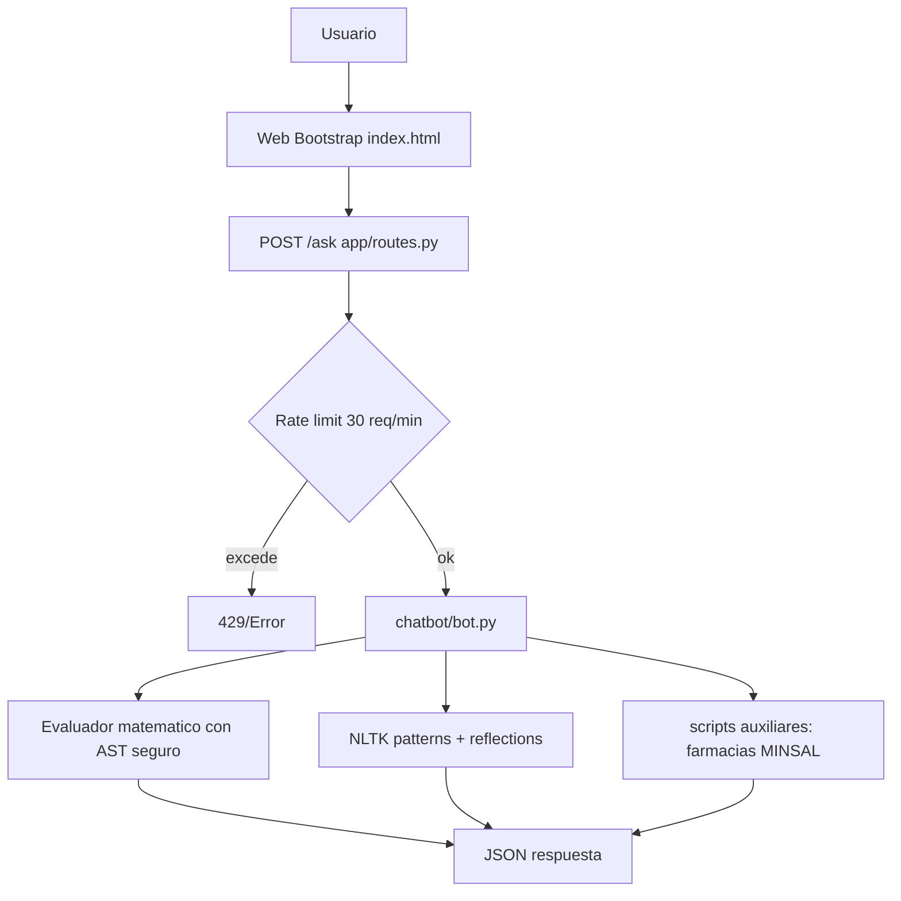

# chatBot-python

Chatbot conversacional en español construido con Flask y NLTK. Responde preguntas, realiza operaciones matemáticas y mantiene diálogos básicos vía interfaz web y API REST.

[](LICENSE)
[](https://python.org)
[](https://flask.palletsprojects.com/)
[](https://github.com/bi0punk/chatBot-python/actions/workflows/ci.yml)

## Contenido

- [Características](#características)
- [Arquitectura](#arquitectura)
- [Stack](#stack)
- [Estructura del repositorio](#estructura-del-repositorio)
- [Requisitos](#requisitos)
- [Instalación](#instalación)
- [Uso](#uso)
- [Configuración](#configuración)
- [Tests / CI](#tests--ci)
- [Roadmap](#roadmap)
- [Licencia](#licencia)

## Características

- Diálogos basados en patrones regex con NLTK (`nltk.chat.util.Chat`).
- Evaluación de expresiones matemáticas (AST seguro) desde el mensaje.
- Interfaz web con Bootstrap 5 y consumo vía API REST (POST `/ask`).
- Más de 40 pares de preguntas/respuestas predefinidas en español.
- Evaluador matemático con operaciones básicas (+, -, *, /).
- Rate limiting (30 peticiones/min por IP) y longitud máxima de entrada (500 caracteres).
- Script auxiliar de farmacias de turno (consulta MINSAL de Chile) en `chatbot/scripts/`.
- Código modular: separación clara entre lógica del bot y aplicación Flask.

## Arquitectura



## Stack

- **Python 3.11+**
- **Flask 3.0** — servidor web y API REST.
- **NLTK** — procesamiento de lenguaje natural (pattern matching).
- **pandas / numpy** — utilidades auxiliares (dataframes en scripts).
- **requests** — consultas HTTP externas.
- **Bootstrap 5** — frontend.

## Estructura del repositorio

```
chatBot-python/
├── run.py                    # Entrypoint Flask (crea la app)
├── app/
│   ├── __init__.py           # Factory create_app()
│   ├── routes.py             # Rutas: / (GET) y /ask (POST) con rate limit
│   └── templates/
│       └── index.html        # UI del chatbot
├── chatbot/
│   ├── __init__.py
│   ├── bot.py                # Lógica NLTK + evaluador matemático
│   └── scripts/
│       └── farmacia.py       # Consulta farmacias de turno (MINSAL)
├── tests/
│   └── test_smoke.py
├── .env.example
├── .github/workflows/ci.yml
├── requirements.txt
└── pyproject.toml
```

## Requisitos

- Python 3.11+.

## Instalación

```bash
git clone https://github.com/bi0punk/chatBot-python.git
cd chatBot-python
pip install -r requirements.txt
```

## Uso

### Iniciar servidor

```bash
python run.py
# Servidor en http://localhost:5000
```

### API REST

```bash
curl -X POST http://localhost:5000/ask \
  -H "Content-Type: application/json" \
  -d '{"messageText": "Hola"}'
# {"message":"¡Hola! ¿En qué puedo asistirte?"}

curl -X POST http://localhost:5000/ask \
  -H "Content-Type: application/json" \
  -d '{"messageText": "2+2"}'
# {"message":"4"}
```

## Configuración

| Variable | Default | Descripción |
|---|---|---|
| `SECRET_KEY` | — | Clave secreta de Flask para sesiones. |
| `FLASK_DEBUG` | `0` | Modo debug (`1` para desarrollo). |

Rate limiting: 30 peticiones/minuto por IP en el endpoint `/ask`. Entrada máxima: 500 caracteres.

## Tests / CI

```bash
pip install pytest ruff
pytest -q
```

GitHub Actions (`.github/workflows/ci.yml`) sobre Python 3.11: `ruff check` + `pytest`.

## Roadmap

- [x] Diálogos NLTK + evaluador matemático seguro
- [x] API REST y web UI
- [ ] Integración con APIs externas
- [ ] Modelo ML para conversación
- [ ] Logging de conversaciones

## Licencia

MIT — ver [LICENSE](LICENSE).